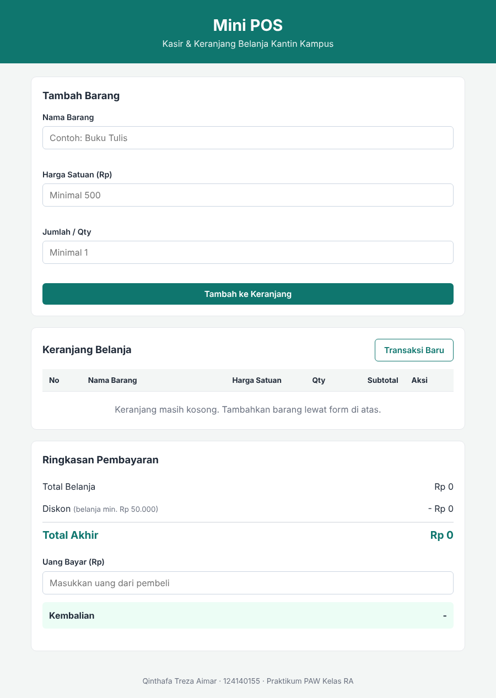
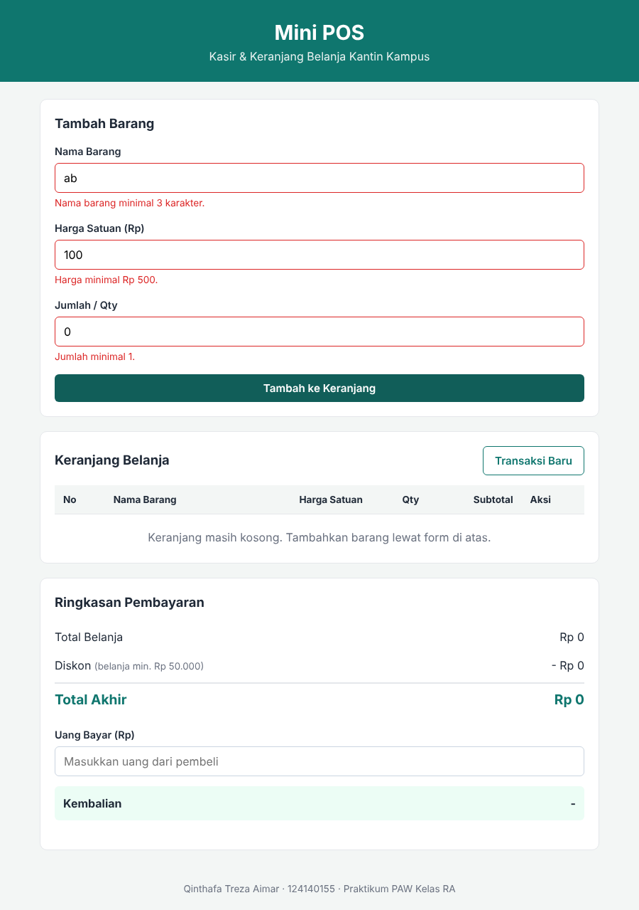
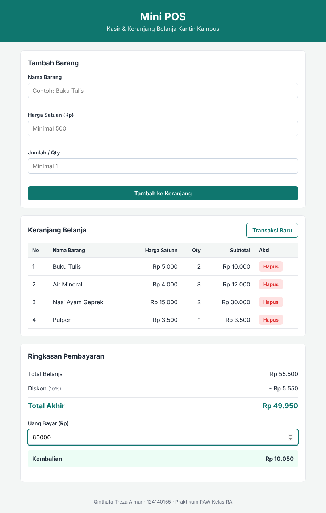

# Mini POS - Kasir & Keranjang Belanja Sederhana

Tugas Praktikum Pengembangan Aplikasi Web - Pertemuan 1: JavaScript Dasar

## Identitas

| | |
|---|---|
| **Nama Lengkap** | Qinthafa Treza Aimar |
| **NIM** | 124140155 |
| **Kelas Praktikum** | RA |

## Deskripsi Aplikasi

Mini POS adalah aplikasi web kasir sederhana untuk kantin atau toko kampus. Kasir memasukkan nama barang, harga satuan, dan jumlah yang dibeli, lalu aplikasi menampilkan daftar belanja dalam bentuk tabel dan menghitung total, diskon, serta uang kembalian secara otomatis.

Tujuan pembuatan aplikasi ini adalah menerapkan materi JavaScript dasar dalam satu studi kasus: variabel dan kondisional, fungsi dan event handler, array dan objek, manipulasi DOM, serta penyimpanan data dengan `localStorage`.

Aplikasi dibuat hanya dengan HTML, CSS, dan JavaScript murni, tanpa library tambahan.

## Panduan Menjalankan

1. Clone atau unduh repository ini.
   ```bash
   git clone https://github.com/qintaboy/pemrograman_web_itera_124140155.git
   ```
2. Buka folder `qinthafatrezaaimar_124140155_pertemuan1` di VS Code.
3. Klik kanan file `index.html`, lalu pilih **Open with Live Server**.
4. Aplikasi terbuka di browser pada alamat `http://127.0.0.1:5500`.

Tanpa Live Server, aplikasi juga bisa dijalankan dengan klik dua kali file `index.html`.

## Struktur Folder

```
qinthafatrezaaimar_124140155_pertemuan1/
├── index.html      # Struktur halaman aplikasi
├── style.css       # Tampilan antarmuka
├── script.js       # Logika aplikasi
├── README.md       # Dokumentasi
├── screenshots/    # Tangkapan layar aplikasi
└── modul/          # File latihan selama mengikuti materi praktikum
```

## Daftar Fitur

**Validasi form input barang**
- [x] Nama barang wajib diisi, minimal 3 karakter
- [x] Harga satuan wajib angka, minimal Rp 500
- [x] Jumlah (qty) wajib bilangan bulat, minimal 1
- [x] Pesan error berwarna merah di bawah input yang salah
- [x] Barang tidak masuk keranjang jika data tidak valid
- [x] Form otomatis dikosongkan setelah barang berhasil ditambahkan

**Kalkulator dan perhitungan otomatis**
- [x] Subtotal per barang (harga satuan × qty)
- [x] Total belanja dari seluruh subtotal
- [x] Diskon otomatis 10% untuk total belanja minimal Rp 50.000
- [x] Total akhir setelah diskon
- [x] Kembalian dihitung otomatis saat uang bayar diketik
- [x] Keterangan jika uang bayar belum mencukupi

**Keranjang belanja dan localStorage**
- [x] Tabel keranjang (No, Nama Barang, Harga Satuan, Qty, Subtotal, Aksi)
- [x] Tombol Hapus di setiap baris, total langsung dihitung ulang
- [x] Isi keranjang tersimpan di `localStorage` dan tidak hilang saat halaman di-refresh
- [x] Tombol Transaksi Baru untuk mengosongkan keranjang dan `localStorage`

**Tampilan**
- [x] Format angka Rupiah (contoh: Rp 15.000)
- [x] Tampilan responsif untuk layar HP

## Tangkapan Layar

### 1. Tampilan form input utama


### 2. Tampilan saat validasi error muncul


### 3. Tampilan hasil perhitungan dan tabel keranjang


## Penjelasan Teknis Singkat

### Struktur data

Seluruh isi keranjang disimpan dalam satu array bernama `keranjang`. Setiap barang adalah objek dengan empat properti:

```javascript
{ id: 1760061234567, nama: "Buku Tulis", harga: 5000, qty: 2 }
```

`id` diisi dengan `Date.now()` supaya setiap barang punya penanda unik untuk fitur hapus.

### Penanganan validasi input

Saat form dikirim, fungsi `tambahBarang()` memanggil `event.preventDefault()` agar halaman tidak reload, lalu menjalankan `validasiForm()`. Fungsi ini memeriksa ketiga input satu per satu:

- Nama dibersihkan dengan `trim()`, lalu dicek tidak kosong dan panjangnya minimal 3 karakter.
- Harga diubah menjadi angka dengan `Number()`, lalu dicek dengan `isNaN()` dan dibandingkan dengan batas minimal 500.
- Qty dicek dengan `Number.isInteger()` untuk memastikan bilangan bulat, dan minimal 1.

Setiap input yang salah diberi pesan lewat fungsi `aturError()`, yang mengisi teks merah di bawah input dan menambahkan class `input-salah`. Jika ada satu saja yang salah, `validasiForm()` mengembalikan `null` sehingga barang tidak ditambahkan. Jika semua benar, fungsi mengembalikan objek barang baru, lalu form dikosongkan dengan `formBarang.reset()`.

### Algoritma kalkulator

Fungsi `hitungRingkasan()` menghitung semua nilai dari array `keranjang`:

1. **Total belanja** dihitung dengan `reduce()`, yang menjumlahkan `harga × qty` setiap barang.
2. **Diskon** bernilai 10% dari total jika total minimal Rp 50.000, dan 0 jika tidak. Penentuannya memakai ternary operator.
3. **Total akhir** = total belanja − diskon.

Fungsi `hitungKembalian()` berjalan setiap kali kolom Uang Bayar berubah (event `input`). Kembalian = uang bayar − total akhir. Jika hasilnya negatif, aplikasi menampilkan keterangan uang belum mencukupi beserta jumlah kekurangannya.

Semua angka ditampilkan lewat `formatRupiah()`, yang memakai `toLocaleString("id-ID")` untuk memberi pemisah ribuan.

### Mekanisme localStorage

`localStorage` hanya dapat menyimpan data berupa teks, sehingga array perlu diubah bentuknya:

- **Menyimpan:** `simpanKeranjang()` mengubah array menjadi teks JSON dengan `JSON.stringify()`, lalu menyimpannya dengan `localStorage.setItem()`. Fungsi ini dipanggil setiap kali barang ditambah atau dihapus.
- **Memuat:** `muatKeranjang()` mengambil teks dengan `localStorage.getItem()` dan mengubahnya kembali menjadi array dengan `JSON.parse()`. Fungsi ini dijalankan sekali saat halaman dibuka. Jika belum ada data, hasilnya array kosong. Proses ini dibungkus `try...catch` agar aplikasi tetap berjalan jika data tersimpan rusak.
- **Menghapus:** tombol Transaksi Baru mengosongkan array dan memanggil `localStorage.removeItem()`.

### Alur pembaruan tampilan

Setiap perubahan data mengikuti urutan yang sama: ubah array `keranjang`, simpan ke `localStorage`, lalu panggil `perbaruiTampilan()`. Fungsi ini menggambar ulang tabel (`renderKeranjang()`), ringkasan (`renderRingkasan()`), dan kembalian (`hitungKembalian()`), sehingga tampilan selalu sama dengan data.

Baris tabel dibuat dengan `document.createElement()` dan diisi lewat `textContent`, bukan `innerHTML`, supaya teks yang diketik pengguna tidak dijalankan sebagai kode HTML.
