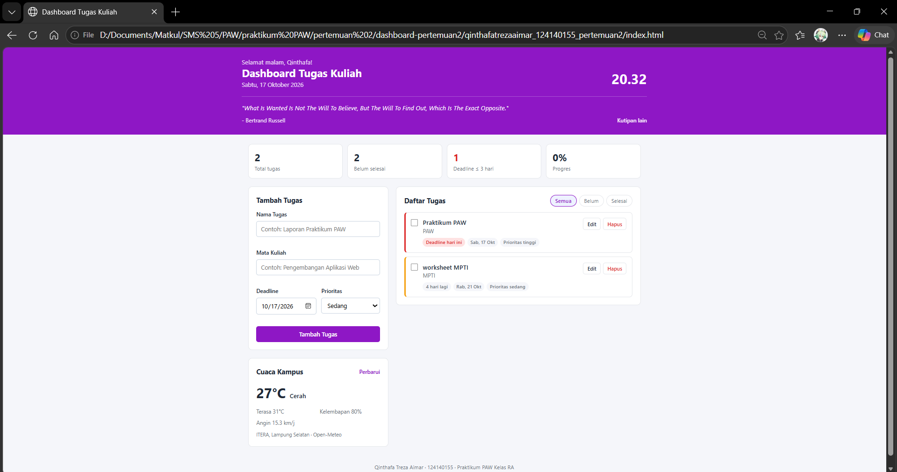
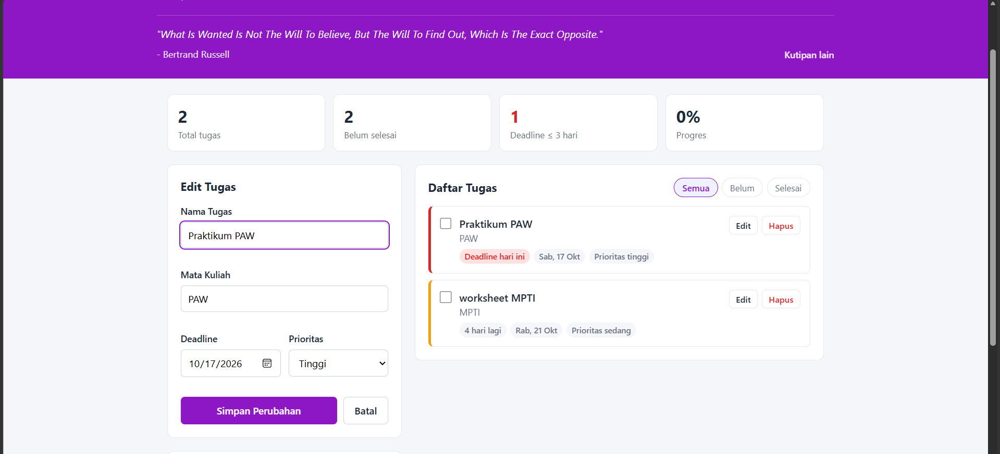

# Dashboard Tugas Kuliah - Personal Dashboard

Tugas Praktikum Pengembangan Aplikasi Web - Pertemuan 2: JavaScript Next Gen (ES6+)

## Identitas

| | |
|---|---|
| **Nama Lengkap** | Qinthafa Treza Aimar |
| **NIM** | 124140155 |
| **Kelas Praktikum** | RA |

## Deskripsi Aplikasi

Dashboard Tugas Kuliah adalah personal dashboard untuk mahasiswa yang ingin memantau tugas kuliah dalam satu halaman. Setiap tugas dicatat bersama mata kuliah, tanggal deadline, dan prioritasnya. Aplikasi menghitung sisa hari menuju deadline, menandai tugas yang mendesak atau terlambat, dan mengurutkan tugas dari deadline terdekat.

Selain daftar tugas, dashboard menampilkan jam dan sapaan sesuai waktu, cuaca terkini di sekitar kampus ITERA, serta kutipan motivasi acak.

Aplikasi dibuat dengan HTML, CSS, dan JavaScript murni (tanpa library), menggunakan fitur-fitur ES6+.

## Cara Menjalankan

1. Clone repository ini.
   ```bash
   git clone https://github.com/qintaboy/pemrograman_web_itera_124140155.git
   ```
2. Buka folder `qinthafatrezaaimar_124140155_pertemuan2` di VS Code.
3. Klik kanan `index.html`, lalu pilih **Open with Live Server**.

Cuaca dan kutipan diambil dari internet, jadi perangkat perlu terhubung ke internet. Tanpa internet, fitur tugas tetap berjalan normal.

## Fitur Aplikasi

- [x] **Tambah tugas** dengan nama tugas, mata kuliah, deadline, dan prioritas
- [x] **Validasi form**: nama tugas minimal 3 karakter, mata kuliah dan deadline wajib diisi
- [x] **Edit tugas**: data tugas dimuat ke form, lalu disimpan ulang
- [x] **Hapus tugas** dengan konfirmasi
- [x] **Tandai selesai** lewat checkbox
- [x] **Filter** tugas: Semua, Belum, Selesai
- [x] **Urutan otomatis**: tugas belum selesai di atas, lalu deadline terdekat, lalu prioritas tertinggi
- [x] **Status deadline**: "Deadline hari ini", "Deadline besok", "x hari lagi", "Terlambat x hari"
- [x] **Ringkasan**: total tugas, belum selesai, deadline ≤ 3 hari, dan persentase progres
- [x] **Penyimpanan localStorage**: data tidak hilang saat halaman di-refresh
- [x] **Cuaca kampus** real-time dari API Open-Meteo
- [x] **Kutipan motivasi** acak dari API DummyJSON Quotes
- [x] **Jam dan sapaan** yang diperbarui setiap detik
- [x] **Tampilan responsif** untuk layar HP

## Tangkapan Layar

### Tampilan utama dashboard


### Validasi form


### Mode edit tugas


## Fitur ES6+ yang Diimplementasikan

Semua nomor baris merujuk ke file `script.js`.

| Fitur ES6+ | Baris | Keterangan |
|---|---|---|
| `const` | 7-25, 39, 45-47 | Konstanta aplikasi dan variabel yang tidak diubah |
| `let` | 347-350 | Variabel `waktu` yang nilainya diubah sesuai jam |
| Arrow function | 30, 38, 44, 52, 54 | Fungsi bantuan `amankanTeks`, `keTanggal`, `hariIniTeks`, `buatId`, `formatTanggal` |
| Arrow function (callback) | 136, 167, 172, 418 | `setInterval`, `map`, `filter` |
| Template literals | 10, 48, 307-318, 396-400, 425-443 | URL API, format tanggal, rendering HTML cuaca, statistik, dan kartu tugas |
| Class `TaskItem` | 60-94 | Model data satu tugas |
| Class `DashboardApp` | 99-445 | State aplikasi, localStorage, fetch, dan render |
| Getter (`get`) | 72, 79, 358 | `sisaHari`, `statusDeadline`, `tugasTampil` |
| Destructuring parameter + default value | 62, 396, 422 | Constructor `TaskItem`, render statistik, `templateTugas` |
| Destructuring objek/array | 39, 218, 242, 267, 298-305, 332 | Mengambil nilai dari objek data, dataset tombol, dan respons API |
| Spread operator | 92, 162, 366 | Menyalin objek/array tanpa mengubah aslinya (immutable) |
| Async/Await + `fetch` | 292-323, 325-340 | `ambilCuaca()` dan `ambilKutipan()` |
| Promise | 139 | `Promise.all` menjalankan dua permintaan API bersamaan |
| Nullish coalescing `??` | 310 | Teks cadangan jika kode cuaca tidak dikenal |

## Penjelasan Teknis Singkat

### Struktur class

`TaskItem` menyimpan data satu tugas (`id`, `judul`, `matkul`, `deadline`, `prioritas`, `selesai`). Getter `sisaHari` menghitung selisih hari dari hari ini ke deadline, dan `statusDeadline` mengubahnya menjadi label. Method `ubah()` tidak mengubah objek lama, tetapi membuat `TaskItem` baru dengan spread operator: `new TaskItem({ ...this, ...perubahan })`.

`DashboardApp` mengelola seluruh aplikasi: menyimpan array `tugas`, membaca dan menulis localStorage, memanggil API, memasang event, dan menampilkan data ke halaman.

### Pengelolaan data (immutable)

Setiap operasi membuat array baru, lalu menyimpan dan menampilkan ulang data:

```javascript
tambahTugas: this.tugas = [...this.tugas, new TaskItem(data)];
editTugas:   this.tugas = this.tugas.map((item) => (item.id === id ? item.ubah(perubahan) : item));
hapusTugas:  this.tugas = this.tugas.filter((item) => item.id !== id);
```

### localStorage

Saat menyimpan, array tugas diubah menjadi teks dengan `JSON.stringify()`. Saat halaman dibuka, teks dibaca dengan `JSON.parse()`, lalu setiap objek diubah kembali menjadi `TaskItem` dengan `map()` supaya getter dan method-nya bisa dipakai lagi. Proses membaca dibungkus `try...catch` agar aplikasi tetap berjalan jika data rusak.

### Pengambilan data API

`ambilCuaca()` dan `ambilKutipan()` adalah fungsi `async` yang memakai `await fetch()`. Jika respons gagal, fungsi melempar error yang ditangkap `catch`, lalu halaman menampilkan pesan gagal (cuaca) atau kutipan cadangan, sehingga dashboard tidak rusak saat offline.

### Event delegation

Tombol Edit, Hapus, dan checkbox pada daftar tugas dibuat ulang setiap render, sehingga event dipasang satu kali pada elemen `<ul>` induknya. Tombol yang diklik dikenali dari atribut `data-aksi` dan `data-id`.

### Keamanan teks

Karena daftar tugas dirender dengan template literal dan `innerHTML`, teks dari pengguna dilewatkan ke fungsi `amankanTeks()` terlebih dahulu agar karakter seperti `<` dan `>` tidak dijalankan sebagai HTML.
