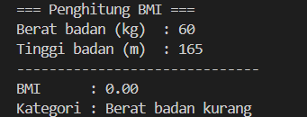
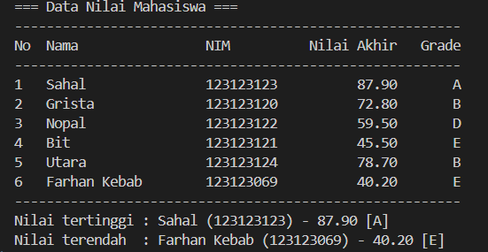
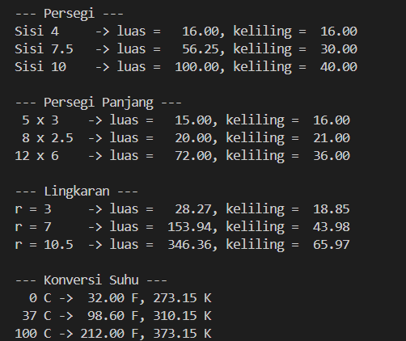

# Python Dasar - Tugas Praktikum Pertemuan 4

Tugas Praktikum Pengembangan Aplikasi Web - Pertemuan 4: Python Dasar

## Identitas

| | |
|---|---|
| **Nama Lengkap** | Qinthafa Treza Aimar |
| **NIM** | 124140155 |
| **Kelas Praktikum** | RA |

## Isi Tugas

| Tugas | Berkas | Ringkasan |
|---|---|---|
| 1 | `tugas1_bmi.py` | Menghitung BMI dan menentukan kategorinya |
| 2 | `tugas2_nilai_mahasiswa.py` | Mengelola data nilai mahasiswa: nilai akhir, grade, tabel, nilai tertinggi dan terendah |
| 3 | `math_operations.py` dan `main.py` | Modul matematika (luas, keliling, konversi suhu) dan program yang memakainya |

## Cara Menjalankan

Prasyarat: [Python](https://www.python.org/downloads/) 3.8 atau lebih baru. Cek dengan `python --version`.
Tidak ada library tambahan yang perlu dipasang.

1. Clone repository, lalu masuk ke folder tugas:
   ```bash
   git clone https://github.com/qintaboy/pemrograman_web_itera_124140155.git
   cd pemrograman_web_itera_124140155/qinthafatrezaaimar_124140155_pertemuan4
   ```
2. Jalankan program yang diinginkan:
   ```bash
   python tugas1_bmi.py
   python tugas2_nilai_mahasiswa.py
   python main.py
   ```

## Penjelasan Program

### Tugas 1: Penghitung BMI (`tugas1_bmi.py`)

Program meminta berat badan (kg) dan tinggi badan (m) lewat `input()`, lalu:

1. Menghitung BMI dengan rumus `berat / (tinggi * tinggi)` (fungsi `hitung_bmi`).
2. Menentukan kategori dengan percabangan `if-elif-else` (fungsi `tentukan_kategori`):

   | BMI | Kategori |
   |---|---|
   | di bawah 18,5 | Berat badan kurang |
   | 18,5 sampai kurang dari 25 | Berat badan normal |
   | 25 sampai kurang dari 30 | Berat badan berlebih |
   | 30 atau lebih | Obesitas |

3. Menampilkan BMI dengan 2 angka desimal (f-string `{bmi:.2f}`) beserta kategorinya.

Input divalidasi oleh fungsi `baca_angka`: jika yang diketik bukan angka atau tidak positif, program meminta ulang (perulangan `while` + `try-except`). Tanda koma (`1,70`) juga diterima.



### Tugas 2: Pengelolaan Data Nilai Mahasiswa (`tugas2_nilai_mahasiswa.py`)

- Data disimpan dalam list berisi 6 dictionary dengan kunci `nama`, `nim`, `nilai_uts`, `nilai_uas`, dan `nilai_tugas`.
- Nilai akhir = 30% UTS + 40% UAS + 30% Tugas (`hitung_nilai_akhir`).
- Grade ditentukan `tentukan_grade`: A (>= 80), B (70-79), C (60-69), D (50-59), E (< 50).
- `proses_data` menambahkan `nilai_akhir` dan `grade` ke setiap mahasiswa.
- `tampilkan_tabel` mencetak tabel rata dengan f-string (Nama, NIM, Nilai Akhir, Grade).
- `tampilkan_ekstrem` mencari mahasiswa dengan nilai akhir tertinggi dan **terendah memakai `max()` dan `min()`.



### Tugas 3: Modul Matematika (`math_operations.py` dan `main.py`)

`math_operations.py` adalah modul berisi:
- konstanta `PI = 3.14159`
- `luas_persegi`, `keliling_persegi`
- `luas_persegi_panjang`, `keliling_persegi_panjang`
- `luas_lingkaran`, `keliling_lingkaran`
- `celsius_ke_fahrenheit`, `celsius_ke_kelvin`

**`main.py`** memakai modul itu dengan **dua cara impor**:

```python
import math_operations # cara 1: lewat nama modul
from math_operations import PI, celsius_ke_fahrenheit, celsius_ke_kelvin  # cara 2
```

Cara 1 dipanggil sebagai `math_operations.luas_persegi(4)`, sedangkan cara 2 langsung `celsius_ke_kelvin(100)`. Semua fungsi diuji dengan beberapa nilai dan hasilnya ditampilkan rapi.



## Konsep Python yang Digunakan

- Variabel dan tipe data: `int`, `float`, `str`, `list`, `dict`
- Operator: aritmatika, perbandingan
- Struktur kendali: `if-elif-else`, `for`, `while`
- Fungsi dengan parameter, nilai kembali, dan docstring
- Struktur data: list berisi dictionary
- Modul: membuat modul sendiri dan mengimpornya dengan dua cara
- f-string untuk memformat angka dan meratakan kolom tabel
- `if __name__ == "__main__":` supaya berkas bisa dijalankan sendiri maupun diimpor tanpa menjalankan programnya
