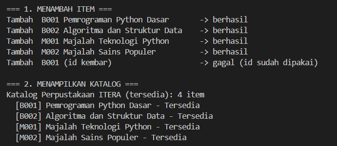
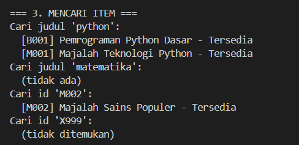
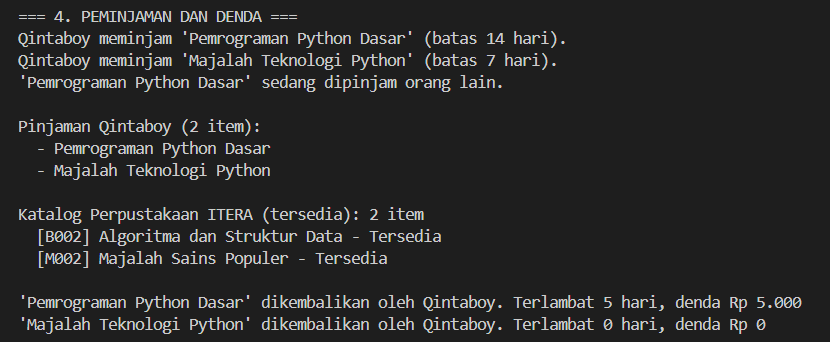
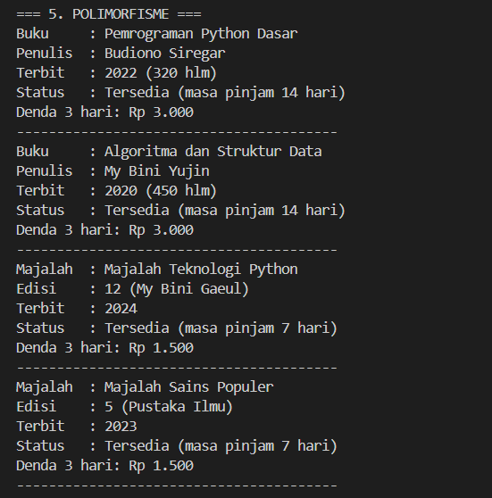
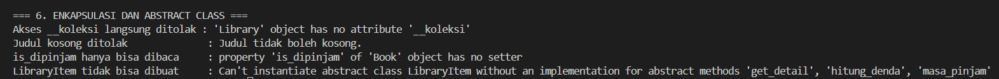

# Python OOP - Tugas Praktikum Pertemuan 5

Tugas Praktikum Pengembangan Aplikasi Web - Pertemuan 5: Python OOP

## Identitas

| | |
|---|---|
| **Nama Lengkap** | Qinthafa Treza Aimar |
| **NIM** | 124140155 |
| **Kelas Praktikum** | RA |

## Isi Folder

```
qinthafatrezaaimar_124140155_pertemuan5/
├── latihan/                        # 7 berkas hands-on dari materi
│   ├── 01_everything_is_object.py
│   ├── 01_procedural_vs_oop.py
│   ├── 02_class_object.py
│   ├── 03_inheritance.py
│   ├── 04_encapsulation.py
│   ├── 05_polymorphism.py
│   └── 06_abstract_class.py
├── tugas_perpustakaan/             # Tugas: sistem manajemen perpustakaan
│   ├── library_item.py             # LibraryItem (abstract), Book, Magazine
│   ├── member.py                   # Member (anggota perpustakaan)
│   ├── library.py                  # Library (koleksi dan pencarian)
│   └── main.py                     # Program pengujian
├── screenshots/                    # Tangkapan layar output program
├── README.md
└── .gitignore
```

## Cara Menjalankan

Prasyarat: [Python](https://www.python.org/downloads/) 3.8 atau lebih baru. Cek dengan `python --version`.
Tidak ada library tambahan yang perlu dipasang.

1. Clone repository, lalu masuk ke folder tugas:
   ```bash
   git clone https://github.com/USERNAME/pemrograman_web_itera_124140155.git
   cd pemrograman_web_itera_124140155/qinthafatrezaaimar_124140155_pertemuan5
   ```
2. Jalankan program perpustakaan (**harus dari dalam** folder `tugas_perpustakaan`):
   ```bash
   cd tugas_perpustakaan
   python main.py
   ```
3. Jalankan berkas latihan (dari folder `latihan`):
   ```bash
   cd ../latihan
   python 03_inheritance.py
   ```

## Deskripsi Program: Sistem Manajemen Perpustakaan

Program memodelkan perpustakaan yang menyimpan **buku** dan **majalah**. Pengguna dapat menambah item, menampilkan katalog item yang tersedia, mencari item berdasarkan judul atau id, serta meminjam dan mengembalikan item beserta perhitungan denda keterlambatan.

### Alur program (`main.py`)

1. **Menambah item**: dua buku dan dua majalah ditambahkan ke `Library`. Penambahan item dengan id yang sudah ada ditolak.
2. **Menampilkan katalog**: hanya item berstatus *Tersedia* yang ditampilkan.
3. **Mencari item**: berdasarkan sebagian judul (tidak membedakan huruf besar dan kecil) atau berdasarkan id.
4. **Peminjaman dan denda**: `Member` meminjam item, mencoba meminjam item yang sedang dipinjam (ditolak), lalu mengembalikannya dan dikenai denda bila terlambat.
5. **Polimorfisme**: seluruh item diproses dengan method yang sama, hasilnya berbeda per jenis item.
6. **Enkapsulasi**: percobaan mengakses atau mengubah data yang dilindungi menghasilkan galat.

### Class yang dibuat

| Class | Berkas | Peran |
|---|---|---|
| `LibraryItem` (abstract) | `library_item.py` | Dasar semua item: id, judul, tahun, status dipinjam |
| `Book` | `library_item.py` | Turunan `LibraryItem`: ditambah penulis dan jumlah halaman |
| `Magazine` | `library_item.py` | Turunan `LibraryItem`: ditambah nomor edisi dan penerbit |
| `Member` | `member.py` | Anggota yang meminjam dan mengembalikan item (maksimal 3 item) |
| `Library` | `library.py` | Menyimpan koleksi, menambah, menampilkan katalog, dan mencari item |

## Penerapan Empat Pilar OOP

### 1. Class dan Object

Setiap hal dalam perpustakaan dimodelkan sebagai class dengan atribut dan method: `Book`, `Magazine`, `Member`, `Library`. Di `main.py`, class-class itu dibuat menjadi objek, misalnya `Book("B001", "Pemrograman Python Dasar", ...)`.

### 2. Inheritance (Pewarisan)

`Book` dan `Magazine` **mewarisi** `LibraryItem`. Atribut dan method yang sama (id, judul, `pinjam()`, `kembalikan()`, `status`) cukup ditulis sekali di kelas induk. Subclass memanggil `super().__init__(...)` lalu menambahkan atributnya sendiri.

### 3. Encapsulation (Pembungkusan)

- **Private (`__`)**: `Library.__koleksi`, `LibraryItem.__dipinjam`, `Member.__nama`, dan `Member.__daftar_pinjam` tidak bisa diakses langsung dari luar class.
- **Protected (`_`)**: `_id_item`, `_judul`, `_penulis`, dan sejenisnya hanya dimaksudkan untuk kelas itu dan turunannya.
- **`@property`**: `is_dipinjam` dan `id_item` hanya bisa dibaca. `judul` dan `Member.nama` punya **setter** yang menolak nilai kosong dengan `ValueError`.

### 4. Polymorphism (Banyak Bentuk)

`get_detail()` dan `hitung_denda()` dipanggil dengan cara yang sama pada setiap item, tetapi hasilnya berbeda tergantung jenis objeknya:

| | `Book` | `Magazine` |
|---|---|---|
| `masa_pinjam` | 14 hari | 7 hari |
| `hitung_denda()` | Rp 1.000 per hari | Rp 500 per hari |
| `get_detail()` | menampilkan penulis dan halaman | menampilkan edisi dan penerbit |

Di `main.py`, satu perulangan `for item in ...: item.get_detail()` cukup untuk semua jenis item, tanpa `if-elif` untuk memeriksa tipenya.

### Abstract Class

`LibraryItem` mewarisi `ABC` dan memiliki tiga anggota abstract: `get_detail()`, `hitung_denda()`, dan property `masa_pinjam`. Class ini **tidak bisa dibuat objeknya** secara langsung, dan setiap subclass wajib mengimplementasikan ketiganya.

## Tangkapan Layar

### Menambah item dan menampilkan katalog


### Mencari item (judul dan id)


### Peminjaman, pengembalian, dan denda


### Polimorfisme


### Enkapsulasi dan abstract class


## Berkas Latihan

| Berkas | Materi |
|---|---|
| `01_everything_is_object.py` | Semua nilai di Python adalah objek (tipe, id, method) |
| `01_procedural_vs_oop.py` | Perbandingan pendekatan prosedural dan OOP |
| `02_class_object.py` | Class, object, atribut class dan instance, `__str__`, `__repr__` |
| `03_inheritance.py` | Pewarisan, `super()`, override, MRO, `isinstance` |
| `04_encapsulation.py` | Public, protected, private, `@property` dan setter |
| `05_polymorphism.py` | Polimorfisme, duck typing, operator overloading |
| `06_abstract_class.py` | Abstract class dan interface dengan modul `abc` |

Kode mengikuti PEP 8 dan setiap class serta method memiliki docstring.
